# Day-ahead electricity demand forecasting for Germany

*Project report · data 2015-01 – 2020-09 · written 2026-11-07*

## Executive summary

We built a day-ahead forecaster for German electricity demand that **issues its forecast at the
same time as the TSOs' official forecast** and uses only information available then. It was
tested in a monthly rolling backtest on 2019 and on Jan–Sep 2020 (COVID), with simulated
weather-forecast errors so the comparison stays fair.

| Day-ahead MAE (GW) | 2019 | Jan–Sep 2020 |
|---|---|---|
| Seasonal naive (same hour last week) | 2.56 | 2.23 |
| Official TSO forecast | 1.99 | 1.46 |
| TSO forecast, bias-corrected | 1.55 | 1.30 |
| Ridge regression | 1.35 | 1.28 |
| **LightGBM ensemble, realistic weather** | **1.00 (1.84 %)** | **1.06 (2.00 %)** |
| LightGBM ensemble, perfect weather (upper bound) | 0.96 | 0.99 |
| LightGBM ensemble, no weather at all | 1.13 | 1.13 |

**Key findings**

1. **Half the official forecast's error.** With realistic weather the ensemble's error is
   **50 % lower than the TSO forecast in 2019** and **36 % lower than the bias-corrected TSO
   forecast**. In 2020 it is 28 % / 19 % lower. Every one of these differences is significant
   (Diebold-Mariano, p < 0.001).
2. **The official forecast is biased, and part of that is the data.** The TSO forecast came out
   +1.33 GW too low on average in 2019. The "actual load" series it's judged against covers a
   growing share of national consumption (81 % → 86 %, 2015–2019). Correcting the bias alone
   removes about 22 % of the TSO's 2019 error. Our ensemble's 2019 bias is 0.03 GW.
3. **Most of the gain comes without weather.** Calendar and holiday modelling, a holiday-cleaned
   weekly lag and level normalisation give 1.13 GW with *no* weather data, already better than
   the bias-corrected TSO forecast. Weather improves that by about 15 % with perfect knowledge;
   realistic forecast error gives back about a quarter of that gain.
4. **Peak-hour error halves:** daily-peak MAE is 1.02 GW vs 2.14 GW for the TSO in 2019.
5. **Robust to the COVID shock.** During the first lockdown (16 Mar – 31 May 2020) the ensemble's
   MAE was 1.25 GW vs 2.06 GW (TSO) and 1.47 GW (bias-corrected TSO). The level-normalised
   model adapted best (1.22 GW).
6. **Where it is still weak:** Easter (the worst four days of 2019), the days before Christmas
   and the first days of the lockdown, all rare or unprecedented events.
7. **Uncertainty needs calibration.** Raw quantile LightGBM intervals covered only **44 %**
   instead of 80 %. A simple online conformal calibration brings coverage to **78–81 %** in both
   test periods.

**Caveats:** weather-forecast errors are simulated, not real archived forecasts; the target
series has documented coverage drift; the data end in Sep 2020 (the final OPSD release).


---

## 1. Problem and setup

**Task.** Forecast Germany's hourly electricity demand (total load, MW) for every hour of the
next day.

**Timing (matched to the official forecast).** The German transmission system operators (TSOs)
publish their day-ahead load forecast around 10:00 local time on the day before. We issue ours at
**09:00 UTC on D-1** for UTC day D (hours 00–23). The newest load value we may use is the hour
starting 07:00 UTC on D-1 (one hour of reporting latency), so the target hours lie
**17–40 hours** after the last observation. Every load-based input therefore uses lags of at
least 48 h, or is read at the issue-time origin.

**Why this matters.** A naive setup (forecast at midnight, use yesterday's same hour) quietly
gives a model ~14 h more information than the official forecaster had. Matching the timing is
what makes the comparison with the TSO forecast meaningful.

## 2. Data

| Dataset | Use | Notes |
|---|---|---|
| Open Power System Data, *Time series* (release 2020-10-06, the final release) | Target `DE_load_actual_entsoe_transparency`; benchmark `DE_load_forecast_entsoe_transparency`; solar/wind generation | 50,400 hourly rows, 2015-01-01 – 2020-09-30, **no missing target hours** |
| Open-Meteo historical weather (ERA5 reanalysis) | Temperature, humidity, wind, cloud cover, shortwave radiation | 5 cities (Berlin, Hamburg, Munich, Cologne, Frankfurt), averaged with population weights |
| `holidays` package | Public holidays for all 16 states | Weighted by state population → "holiday share" between 0 and 1 |

Everything is reproducible with `uv run fetch-data`; sources, licences and retrieval dates are in
the README.

### 2.1 Data-quality check: the target series drifts

Comparing ENTSO-E's annual load with official German gross electricity consumption
(Destatis/AGEB; BDEW for 2019):

| Year | ENTSO-E load (TWh) | Official gross consumption (TWh) | Coverage | TSO forecast bias (GW) |
|---|---|---|---|---|
| 2015 | 479.5 | 595.1 | 80.6 % | +0.47 |
| 2016 | 487.0 | 594.7 | 81.9 % | **+1.56** |
| 2017 | 492.1 | – | – | +0.45 |
| 2018 | 498.9 | ≈584 | 85.4 % | +0.48 |
| 2019 | 490.5 | 569.0 | 86.2 % | **+1.33** |

The ENTSO-E series covers a **growing share** of national consumption, and its year-to-year
changes don't match the official ones (2016: +1.6 % vs −0.1 %). The TSO forecast's large
positive bias in 2016 and the first half of 2019 lines up with these level shifts. So part of
the TSO forecast's apparent error comes from **reporting changes in the "actual" series**, not
from bad forecasting.

**Consequences for the project:**
1. We add a **bias-corrected TSO benchmark**: the TSO forecast plus its trailing 28-day mean
   error, using only errors known at issue time. This is the fair bar to clear.
2. Our main model predicts load **relative to its recent 28-day level**, so slow level shifts
   (whatever their cause) don't turn into systematic error.

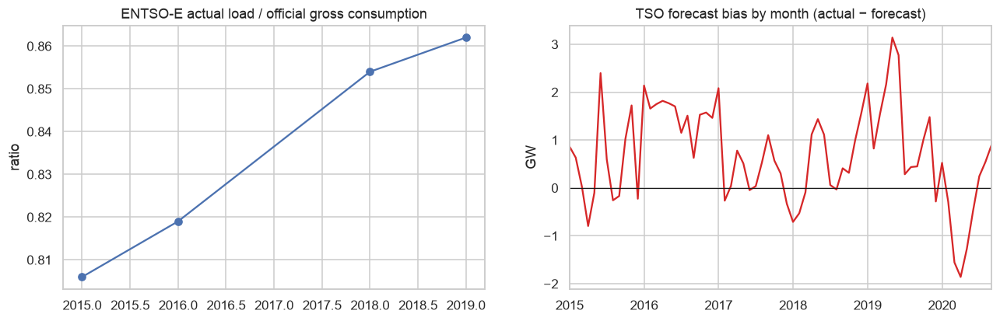
*Left: ENTSO-E load as a share of official consumption. Right: monthly bias of the TSO forecast.*

## 3. What the exploratory analysis showed

(Notebook `01_eda.ipynb`; figures `reports/figures/01–08`.)

- **The calendar dominates.** Relative to Tue–Thu, demand is 97.5 % on Mondays, 97.8 % on
  Fridays, **84 %** on Saturdays and **77 %** on Sundays, with different daily shapes (late
  Monday ramp, flat weekend mornings).
- **Temperature matters, nonlinearly.** The hourly correlation (−0.07) is misleading because the
  daily cycle hides it. On working-day daily means it is **−0.76**: a heating curve from about
  63.6 GW below 5 °C down to a minimum near 17 °C, then a slight rise above 22 °C from cooling.
- **Holidays are large and graded.** National holidays cut weekday demand by **19 %**; regional
  holidays scale with the share of the population off (−5.7 % at 20–50 %, −9.3 % at 50–80 %).
  The Christmas period is its own regime.
- **Weekly memory beats daily memory.** Autocorrelation is 0.91 at 168 h vs 0.76 at 24 h.
- **COVID-19 was a large shock.** Weekly demand fell by up to **14.4 %** (week ending
  2020-04-12) against the 2017–19 average; −9 % in Apr–May, still −4.6 % in Jul–Sep.
- **Slow decline after 2018**, partly from rooftop solar used on site.

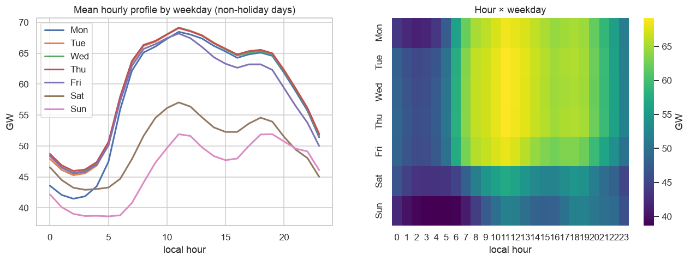
*Average hourly demand profile by weekday (non-holiday days).*

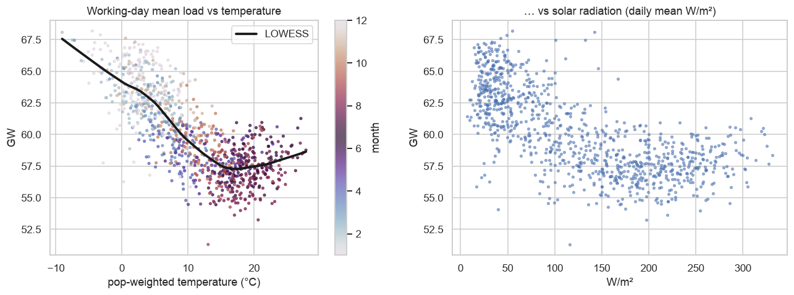
*Working-day demand vs temperature (heating curve) and solar radiation.*

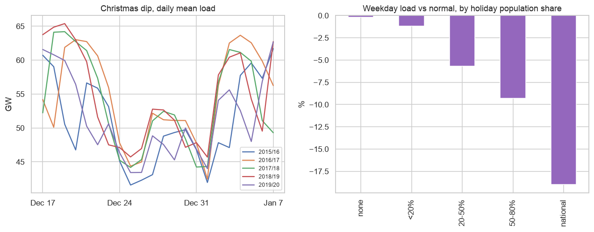
*Christmas dip by year, and weekday demand drop by holiday population share.*

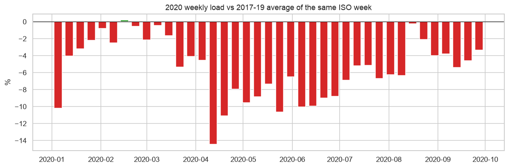
*2020 weekly demand vs the 2017–19 average for the same week.*

## 4. Method

### 4.1 Features (`forecast_features.py`)

All 38 features are available at the 09:00 UTC D-1 issue time. A test changes every load value
after the cut-off and checks that the target day's features don't move.

| Group | Features |
|---|---|
| Calendar (local time, DST-aware) | hour, weekday, month, day-of-year (sin/cos), weekend flag |
| Holidays | population-weighted holiday share; Christmas period; **bridge days** (Mon before / Fri after a holiday, weighted); days to / since the nearest major holiday; holiday share of the lag days |
| Load lags | same hour 2, 3, 7, 14 days earlier; **holiday-cleaned weekly lag** (skips back a week when last week's day was a holiday) |
| State at issue time | last known value; mean of the last 24 h and 7 days; **28-day level** |
| Weather | population-weighted temperature, humidity, wind, cloud cover, radiation; per-city temperature; heating (<15.5 °C) and cooling (>22 °C) degree-hours; 24 h / 72 h smoothed temperature (building inertia); daily mean temperature; temperature 24 h earlier |

### 4.2 Models (`models.py`)

| Model | Description |
|---|---|
| Naive | same hour 2 days ago; same hour last week; mean of the last 4 same weekdays |
| TSO | official day-ahead forecast; **bias-corrected** version (+ trailing 28-day error) |
| Ridge | linear model on the normalised target; 24 × 3 one-hot hour × day-type profile + all features |
| LightGBM raw | gradient-boosted trees predicting load in MW |
| LightGBM normalised | predicts load ÷ 28-day level, with load features scaled the same way |
| Ensemble | average of the two LightGBMs |
| Quantile LightGBM | normalised model with pinball loss at the 10 % and 90 % quantiles → 80 % interval |

### 4.3 Validation (`backtest.py`, `tuning.py`)

- **Rolling origin, monthly refits.** For each test month the model is trained on all data up to
  two days before the month starts (expanding window from 2015-02), then forecasts every day of
  the month with the issue-time features.
- **Tuning on 2018 only**: Optuna, 20 trials per LightGBM, one validation month per quarter
  (Jan/Apr/Jul/Oct 2018). Ridge α from a small grid. The test years were never used for any
  choice.
- **Test periods:** 2019 (a normal year, 8,760 h) and Jan–Sep 2020 (COVID stress test, 6,576 h).
- **Weather scenarios.** Our weather inputs are reanalysis *actuals*, i.e. a perfect weather
  forecast, which the TSOs didn't have. So every LightGBM runs three ways:
  - `actual`: perfect weather (optimistic upper bound)
  - **`noisy`**: trained on actual weather, tested with simulated day-ahead forecast errors
    (smooth AR(1) errors, temperature σ ≈ 1.3 °C, radiation ±25 %, cloud ±15 pts, wind ±3 km/h,
    humidity ±6 pts). **This is the realistic setting and our headline.**
  - `none`: no weather features at all (lower bound)
- **Metrics:** MAE (main), RMSE, MAPE, MAE of the daily peak; **Diebold-Mariano tests** on daily
  mean absolute errors (Newey-West variance, HLN correction); pinball loss and empirical
  coverage for the intervals.

## 5. Results

### 5.1 Accuracy

Full table: `reports/results/metrics.csv` · figure `11_headline_mae.png`.

| Model | MAE 2019 | RMSE 2019 | MAPE 2019 | Peak MAE 2019 | MAE 2020 | MAPE 2020 |
|---|---|---|---|---|---|---|
| Same hour 2 days ago | 7.38 | 9.74 | 13.6 % | 8.61 | 6.67 | 12.9 % |
| Same hour last week | 2.56 | 4.47 | 4.7 % | 2.71 | 2.23 | 4.3 % |
| Mean of last 4 same weekdays | 2.75 | 4.33 | 5.1 % | 2.86 | 2.51 | 4.8 % |
| TSO official | 1.99 | 2.49 | 3.5 % | 2.14 | 1.46 | 2.8 % |
| TSO bias-corrected | 1.55 | 1.99 | 2.9 % | 1.65 | 1.30 | 2.5 % |
| Ridge | 1.35 | 1.93 | 2.5 % | 1.31 | 1.28 | 2.5 % |
| LightGBM raw (noisy wx) | 1.02 | 1.31 | 1.9 % | 1.03 | 1.12 | 2.2 % |
| LightGBM normalised (noisy wx) | 1.02 | 1.32 | 1.9 % | 1.07 | 1.06 | 2.0 % |
| **Ensemble (noisy wx)** | **1.00** | **1.29** | **1.8 %** | **1.02** | **1.06** | **2.0 %** |

*All errors in GW.* "Same hour 2 days ago" is so poor because, at a 09:00 issue time, the
2-day lag compares Mondays with Saturdays and Saturdays with Thursdays.

The two LightGBMs complement each other. The raw model is slightly better in a normal year;
the normalised one is better after the COVID level shift (1.06 vs 1.12 GW in 2020). Averaging
them is the best or tied-best in both periods.

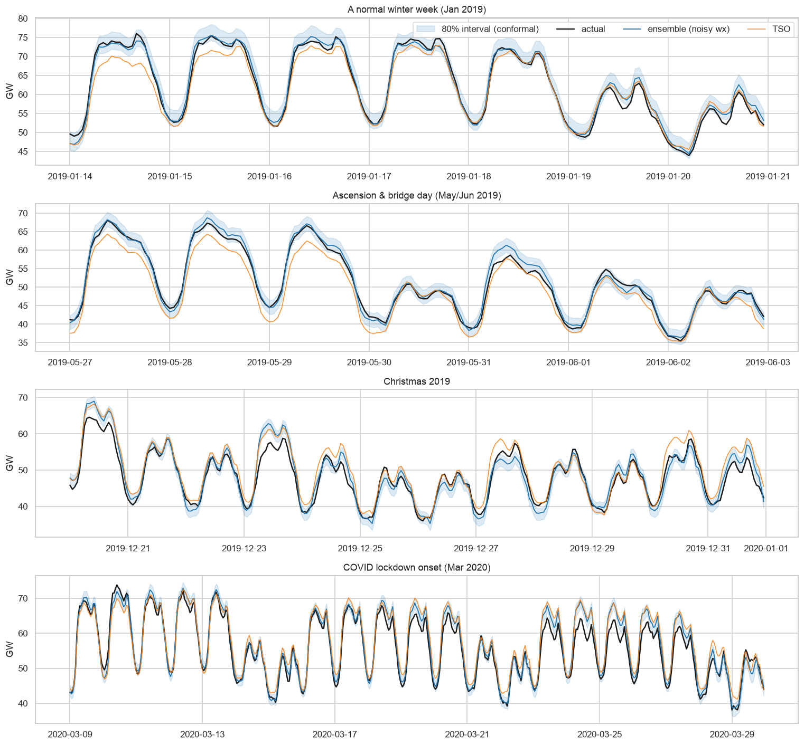
*Example forecasts: a normal week, Ascension with a bridge day, Christmas, and the start of the COVID lockdown. Shaded: calibrated 80 % interval.*

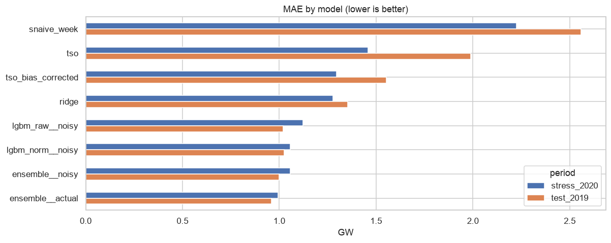
*MAE by model and test period (lower is better).*

### 5.2 Value of weather information

| Ensemble MAE (GW) | 2019 | 2020 |
|---|---|---|
| No weather | 1.126 | 1.125 |
| Realistic (noisy) weather forecast | 1.000 | 1.056 |
| Perfect weather (reanalysis) | 0.958 | 0.994 |

Weather improves on the calendar-and-lags model by about 11 % (2019) under realistic forecast
errors. Simulated forecast errors cost 0.04–0.06 GW compared with perfect weather. So our
headline isn't inflated by perfect weather: even the no-weather model beats both TSO benchmarks.

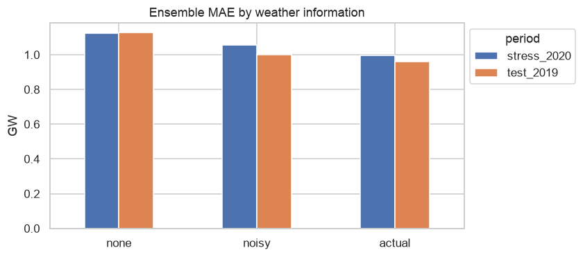
*Ensemble MAE without weather, with realistic (noisy) weather and with perfect weather.*

### 5.3 Statistical significance

Diebold-Mariano tests on daily mean absolute errors (`reports/results/dm_tests.csv`); negative
difference = ensemble better.

| Ensemble (noisy wx) vs | 2019: Δ MAE (GW) | p | 2020: Δ MAE (GW) | p |
|---|---|---|---|---|
| TSO | −0.99 | < 0.001 | −0.40 | < 0.001 |
| TSO bias-corrected | −0.55 | < 0.001 | −0.24 | < 0.001 |
| Ridge | −0.35 | < 0.001 | −0.22 | < 0.001 |
| Seasonal naive | −1.56 | < 0.001 | −1.17 | < 0.001 |

### 5.4 Error analysis (2019, realistic weather)

| MAE by day type (GW) | Ensemble | TSO | TSO bias-corr. |
|---|---|---|---|
| Workday | **0.99** | 2.26 | 1.46 |
| Weekend | **0.95** | 1.36 | 1.66 |
| Public holiday | **1.48** | 1.50 | 2.26 |
| Christmas period | **1.54** | 2.08 | 2.31 |

- **The biggest gain is on ordinary workdays** (0.99 vs 2.26 GW). That's where the TSO bias
  hurts most.
- **Holidays remain the hardest days.** The ensemble only ties the TSO on public holidays. The
  worst four days of 2019 were **Easter, 19–22 April** (daily MAE 2.4–3.9 GW). Good Friday has
  only four training examples, and Easter Saturday isn't a public holiday but behaves like a
  partial one. The TSO forecast handles Easter better, presumably with expert holiday
  profiles.
- **Bias:** ensemble +0.03 GW (2019) and −0.16 GW (2020), vs the TSO's +1.33 / −0.36 GW.
- **By hour**, ensemble errors range from about 0.87 GW at night to 1.13 GW in the afternoon
  (peak around 16:00 local), compared with 1.7–2.3 GW for the TSO. **By month** they are highest
  in April (Easter) and in December/January (`13_error_breakdown.png`).

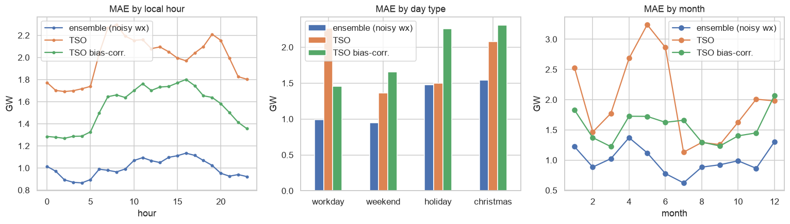
*Ensemble vs TSO error by hour, day type and month (2019).*

### 5.5 The COVID-19 shock

| MAE (GW) | Lockdown, 16 Mar – 31 May 2020 | Jun – Sep 2020 |
|---|---|---|
| LightGBM normalised | **1.22** | **0.84** |
| Ensemble | 1.25 | 0.85 |
| LightGBM raw | 1.38 | 0.92 |
| TSO bias-corrected | 1.47 | 0.96 |
| TSO | 2.06 | 1.02 |

Every model over-forecasts during the first week or two of the lockdown, since nothing in the
history looked like it. The level-normalised model recovers fastest: once the 28-day level and
recent lags reflect the new demand, its relative daily and weekly shape is still correct
(`15_covid_adaptation.png`). This is exactly why we predict relative to the recent level.

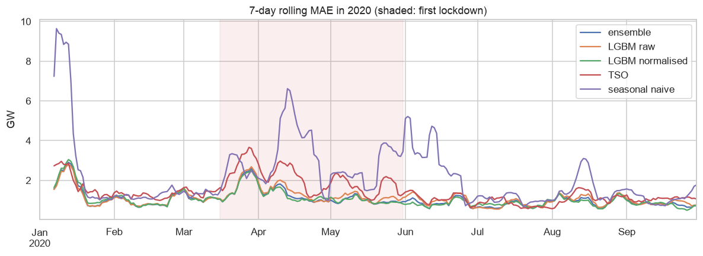
*7-day rolling MAE through 2020; shaded: first lockdown.*

### 5.6 Prediction intervals

| 80 % interval, 2019 (noisy wx) | Coverage | Mean width |
|---|---|---|
| Quantile LightGBM (q10–q90) | 43.6 % | 1.66 GW |
| Conformalised quantile regression (CQR) | 79.6 % | 3.41 GW |
| **Conformal around the ensemble** | **79.2 %** | **3.17 GW** |

(2020: 44.5 % / 80.7 % / 79.5 %.) The raw quantile models are far too confident. Large trees
(about 180 leaves, 1,500 rounds) fit the training quantiles very closely, so their out-of-sample
spread is underestimated. Online conformal calibration fixes this cheaply. It uses only errors
known at issue time (lagged 48 h, 56-day window), so it also adapts to regime changes such as
COVID. The simple variant (empirical error quantiles around the point ensemble) is the narrower
of the two calibrated methods, has the lower pinball loss, and doesn't need the quantile models
at all. Coverage is about 72–76 % in the afternoon and 80–85 % at night
(`16_interval_coverage.png`), so calibrating per hour would be a cheap refinement.

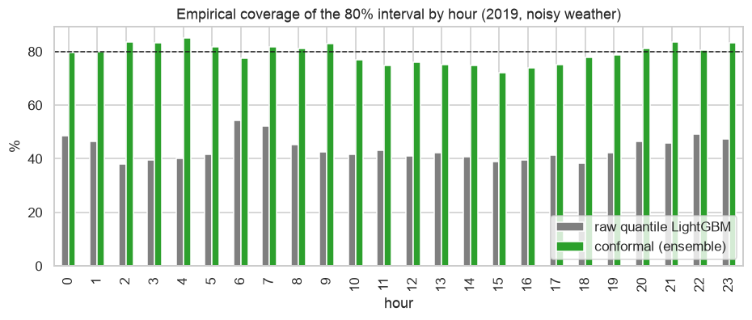
*Coverage of the 80 % interval by hour: raw quantile models vs conformal calibration.*

### 5.7 What drives the model (SHAP)

Mean |SHAP| of the normalised LightGBM, 2019 sample, as % of the 28-day level:

| Feature | Effect | Feature | Effect |
|---|---|---|---|
| holiday-cleaned weekly lag | 7.6 % | load 3 days earlier | 0.5 % |
| load 14 days earlier | 1.8 % | load 2 days earlier | 0.6 % |
| load 7 days earlier | 1.8 % | days to next holiday | 0.5 % |
| hour of day | 1.7 % | holiday share | 0.5 % |
| day of week | 1.4 % | days since last holiday | 0.5 % |
| last known load | 0.7 % | wind speed | 0.6 % |

- The **holiday-cleaned weekly lag** dominates, which validates replacing holiday-contaminated
  lags.
- Holiday features together (share, days to/since, bridge days, lag-day holiday flags) carry
  much of the remaining signal.
- **Wind speed** is the strongest weather feature, ahead of temperature. A likely reason is that
  the ENTSO-E load is measured at transmission level, so wind and solar generation inside
  distribution grids reduce measured "load". This is worth confirming with the generation
  columns (see next steps). The *direct* SHAP effect of temperature is small (about ±0.2 % of
  level) with a clear rise above about 18 °C (cooling). The heating effect is spread across
  heating degree-hours, smoothed temperature and the seasonal and lag features, which already
  "know" it is winter (`18_shap_dependence.png`).
- **Holiday share** has a small *average* effect because holidays are rare, but on a national
  holiday it lowers the forecast by 4–13 % of level, scaling with the population share off.

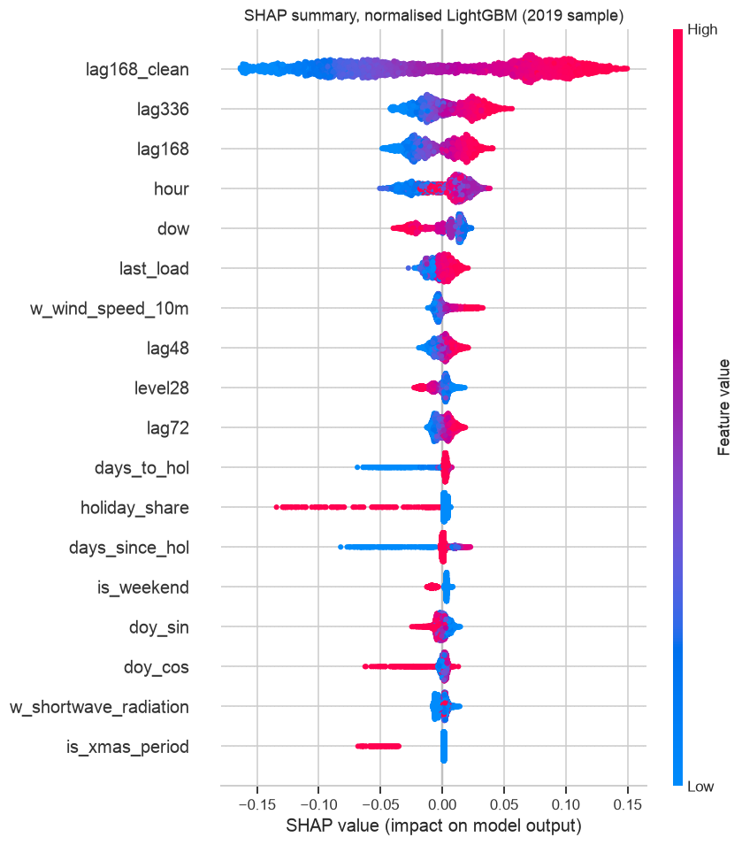
*SHAP summary of the normalised LightGBM (2019 sample).*

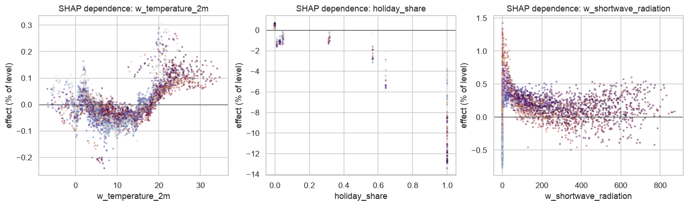
*SHAP dependence for temperature, holiday share and solar radiation.*

## 6. Implementation

```
uv run fetch-data     → data/raw (OPSD 2020-10-06, Open-Meteo) → data/interim (Germany load, weather)
uv run run-backtest   → features → [tuning on 2018] → 11 rolling backtests → conformal intervals
                        → data/processed/predictions.parquet + reports/results/*.csv
notebooks/03_end_to_end.ipynb → loads results, re-runs leakage check & SHAP, all figures
```

| Module | Responsibility |
|---|---|
| `data.py` | reproducible download (pinned OPSD release, retries), interim parquet tables |
| `features.py` | local-time calendar (DST), population-weighted state holidays |
| `forecast_features.py` | issue-time-safe feature matrix; weather-forecast noise simulator |
| `baselines.py` | naive baselines, bias-corrected TSO |
| `models.py` | Ridge, LightGBM raw / normalised / quantile behind one `fit/predict` interface |
| `backtest.py` | monthly expanding-window backtest (2-day gap before each test month) |
| `tuning.py` | Optuna TPE, 2018 only, defaults enqueued as the first trial |
| `evaluation.py` | metrics, peak MAE, Diebold-Mariano (HLN), pinball, coverage, conformal calibration |
| `pipeline.py` | orchestration, caching of tuned params, `--metrics-only` recompute |

**Leakage controls**, each covered by a test in `tests/`:
- Features for day D don't change when any load after the issue cut-off changes.
- All load lags are ≥ 48 h (40 h needed).
- The backtest only trains on data before the test month (minus a 2-day gap).
- Bias correction and conformal calibration use errors lagged ≥ 48 h.
- Tuning never sees 2019–2020.

**Environment:** Python 3.12 via uv (lockfile committed), LightGBM 4, scikit-learn, Optuna,
SHAP. 15 tests. Runtime on a laptop: about 2.2 h for the 11 backtests with the tuned (large)
models, roughly 12.5 min per backtest. Tuning (2 × 20 Optuna trials) took several hours, but
it bought little: on 2019 with perfect weather, raw LightGBM scored 0.98 GW tuned vs 1.01 GW
with default parameters (about 2.6 %), so smaller and faster defaults are a reasonable trade.

## 7. Limitations

- **Simulated weather forecasts.** Real archived day-ahead forecasts (e.g. DWD/ECMWF) would make
  the weather comparison exact. Our noise model is plausible but generic.
- **Target definition drift.** "Actual load" isn't a fixed share of national consumption. A model
  can look good partly by tracking reporting changes. The bias-corrected TSO benchmark and the
  normalised model reduce, but don't remove, this effect.
- **Timing approximation.** We assume one hour of data latency and a 09:00 UTC issue time. The
  TSO forecast may use slightly different information (it does use real weather forecasts).
- **Old data.** OPSD stopped at Sep 2020. Since then, energy-crisis demand reduction (2022) and
  more rooftop solar have changed the load pattern.
- **Hyperparameters** were tuned once on 2018 with 20 trials. A wider search or early stopping
  could make the models much smaller with similar accuracy.

## 8. Next steps

1. **Easter and rare-holiday features:** explicit flags for Good Friday through Easter Monday,
   the days before Christmas and Whit Monday, or a holiday-specific correction model.
2. **Embedded renewables:** add forecasts of solar and wind generation as features, testing the
   hypothesis behind the strong wind effect.
3. **Per-hour conformal intervals** for even coverage across the day.
4. **Real weather forecasts and recent data:** ENTSO-E Transparency API (free token) and
   archived Open-Meteo forecasts to extend the study to 2021–2025.
5. **Faster pipeline:** run the backtests in parallel, use early stopping, save each backtest as
   it finishes, and drop the quantile models in favour of conformal intervals (about 5× faster).

